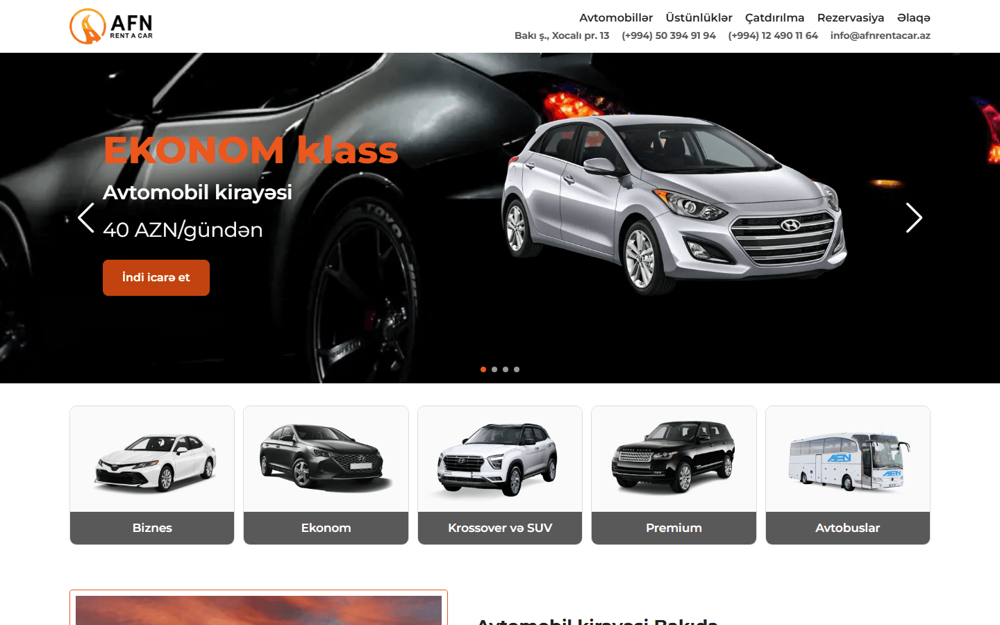

# AFN rent a car – car rental landing page (practice clone)

[](https://codelady-ship.github.io/AFN-rent-a-car-fiqma/)

A responsive car rental landing page built from the **AFN rent a car Figma design** as a **practice clone (təlim layihəsi)**. Car data is loaded from a JSON file, which can also be served as a REST API with **json-server**. The car list and prices are sample data.

> AZ: AFN rent a car Figma dizaynı əsasında hazırlanmış təlim layihəsi. Avtomobillər JSON-dan (json-server və ya statik fayl) yüklənir; qiymətlər nümunədir.



## Features

- Hero slider (Swiper) with rental classes; "İndi icarə et" filters the car list.
- Class tiles and category filter buttons (Ekonom, Biznes, Premium, Krossover və SUV, Avtobuslar).
- Car cards rendered from data, with a **"Hamısını göstər" / "Daha az göstər"** toggle (6 cards first).
- **Car detail modal** (native `<dialog>`) with specs and a "reserve this car" button that pre-selects the car in the form.
- Advantages, delivery and reservation sections.
- **Reservation form** with validation (name, phone, car, dates; the return date must be after the pick-up date), a live price estimate and a demo confirmation dialog. Nothing is sent to a server.
- Hamburger menu on mobile, `tel:`/`mailto:` links, skip link and keyboard-accessible controls.
- SEO: title, description, canonical, Open Graph/Twitter tags, favicon, `robots.txt`, `sitemap.xml`, alt text on every image.
- Images converted to WebP (largest about 130 KB).

## Tech stack

HTML5, CSS3 (Grid, Flexbox, media queries), vanilla JavaScript, [Swiper 10.1.0](https://swiperjs.com/) and [axios 1.7.9](https://axios-http.com/) from jsDelivr (pinned versions), and [json-server](https://github.com/typicode/json-server) for the optional local API.

## Run locally

Static mode (the same as GitHub Pages; data comes from `backend/rentAcar.json`):

```bash
git clone https://github.com/codelady-ship/AFN-rent-a-car-fiqma.git
cd AFN-rent-a-car-fiqma
npx serve .            # open the printed URL
```

With the json-server REST API:

```bash
cd backend
npm install
npm start              # json-server rentAcar.json --port 3000
# endpoints: http://localhost:3000/slides, /categories, /cars, /cars/1
```

In a second terminal, serve the page from the project root (`npx serve .`) and open it with the `api` parameter:
`http://localhost:<serve-port>/?api=http://localhost:3000`.
If the API is not reachable, the page falls back to the static JSON file.

## Deployment

GitHub Pages serves the `main` branch from the repository root: https://codelady-ship.github.io/AFN-rent-a-car-fiqma/.
The old address `rentacar.html` redirects to the root.

## What I learned

- Loading and rendering data with axios, and falling back from an API to a static file.
- Building filters, a show-all toggle and a modal without a framework.
- Form validation with clear error messages and `aria-invalid`.
- Replacing a duplicated CSS framework setup with a small custom stylesheet.
