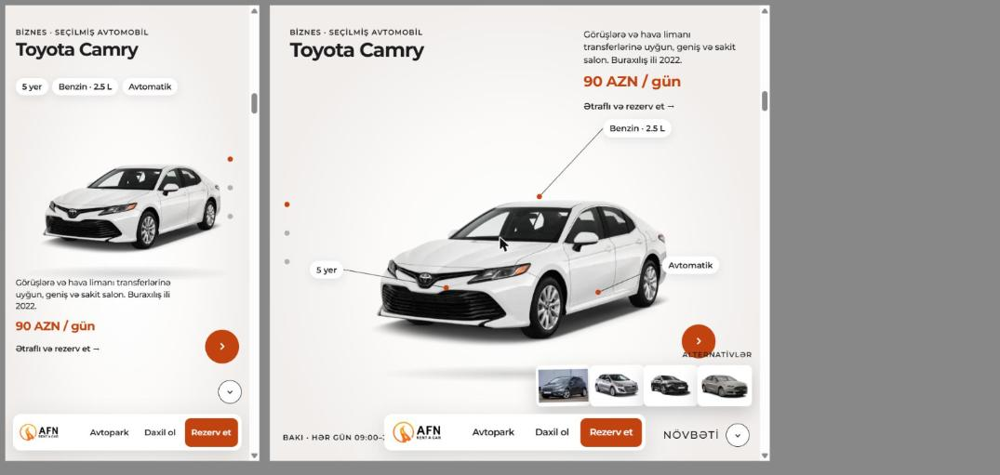
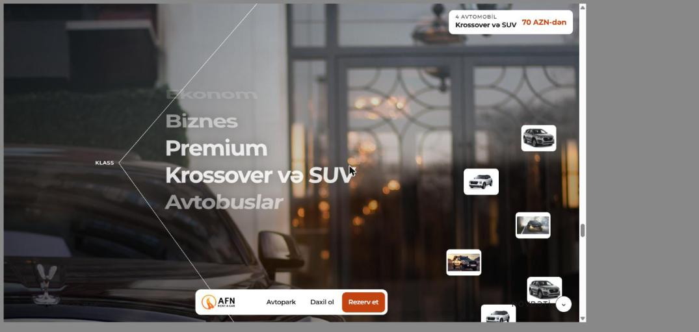

# AFN rent a car – full-stack car rental site (practice project)

A car rental site for Baku built from the **AFN rent a car Figma design** as a **practice project (təlim layihəsi)**. The home page is a scroll-driven story; behind it there is a real booking system: a **React + TypeScript** frontend and a **Node.js + Express + MongoDB** REST API with customer and admin accounts. Cars, prices and contact details are sample data.

> AZ: AFN rent a car Figma dizaynı əsasında full-stack təlim layihəsi. Ana səhifə scroll ilə açılan hekayədir; arxasında real rezervasiya sistemi var: avtopark və filtrlər, avtomobil səhifəsi, onlayn rezervasiya (qiyməti server hesablayır, eyni günlərə ikinci rezervasiya mümkün deyil), müştəri hesabı və admin paneli. API qoşulmayanda sayt brauzerdə demo rejimində işləyir.

| Phone 390 + tablet 768 | Desktop 1280 |
| --- | --- |
|  |  |

More in [`docs/screenshots/`](docs/screenshots/).

## Features

**Landing page (scroll story)**
1. Car photos fly past while the headline "Bakıda avtomobil icarəsi – bir klik uzağınızda" arrives word by word.
2. The gap between two words opens into the featured car: spec callouts (seats, fuel and engine, gearbox), price, a "next car" button and a deck of alternatives that link to the car pages.
3. "Niyə AFN?" panel, then the trip-kit grid: the card flies from the column into the grid, and "+" adds the extra (GPS, child seat, extra driver, full insurance, Wi-Fi, roof box) to the booking.
4. Giant words "Sür · kəşf et · qayıt" over an orange band.
5. "Klassınızı seçin" opens into a drum of the five car classes; click a class to spin to it, the chip links to the filtered fleet.
6. A photo pile (with a mouse, a trail of photos follows the cursor) and the "Avtomobilinizi bu gün rezerv edin" call to action.
7. FAQ and footer with contacts.

Scrolling is always native: stages are `position: sticky`, nothing listens to the wheel or rewrites the scroll position, so wheel, keyboard, touch and the scrollbar all work in both directions. Cursor and magnetic-button effects run only with a fine pointer; with `prefers-reduced-motion` the story cuts between still poses.

**Pages:** fleet with filters in the URL (class, search, price, seats, gearbox, fuel, free on dates, sort), car detail (busy days, reviews), four-step booking with a live server quote, sign-in/sign-up, "my bookings" with cancel, contact form, admin panel (stats, bookings with status changes, car CRUD, messages).

**Booking rules (server side):** real calendar dates, no past days, at most 60 days, the return day is free for the next pick-up, the price is calculated on the server, and double booking is impossible even for parallel requests (one document per booked car-day with a unique `{car, day}` index). Customers only see and cancel their own bookings. Details in [`docs/API.md`](docs/API.md).

**SEO / GEO:** one `h1`, semantic sections, meta and Open Graph tags, `AutoRental` and `FAQPage` JSON-LD that match the visible content, `sitemap.xml`, `robots.txt` and `llms.txt` generated at build time, Azerbaijani `lang`, brand and tech names marked `translate="no"`.

## Tech stack

- **Frontend** (`frontend/`): React 18, Vite 6, TypeScript, Tailwind CSS v4, React Router. Photos as lazy-loaded WebP, Montserrat from Google Fonts.
- **Backend** (`backend/`): Node.js 20, Express 5, TypeScript, MongoDB with Mongoose 8, zod validation, bcrypt passwords, JWT auth (customer and admin), helmet, CORS allow-list, rate limits on sign-in and public forms.
- **Tests:** backend – vitest + supertest on an in-memory MongoDB (30 tests: overlaps, same-day, end before start, past and impossible dates, parallel requests, ownership, status flow, price, auth, rate limit, reviews, contact). Frontend – vitest for the scroll-story maths and the offline demo backend (14 tests).
- **Hosting:** Vercel (frontend), Render free web service (API, `render.yaml`), MongoDB Atlas free cluster. A GitHub Pages workflow is included as an alternative.

## Architecture

```
React app (Vercel) ──fetch──▶ Express API /api (Render) ──▶ MongoDB Atlas
      │
      └── no VITE_API_URL, or the API cannot be reached for reading:
          in-browser demo backend (same rules, data in localStorage, a banner says so)
```

The frontend imports the shared catalogue, demo data and date helpers directly from `backend/src/` so both sides use the same rules and prices. The API address is fixed at build time (`VITE_API_URL`); it cannot be changed from the page address.

## Run locally

Frontend only (demo mode, no database needed):

```bash
cd frontend
npm install
npm run dev        # http://localhost:5173
npm test
```

Demo admin: the **Demo admin kimi daxil ol** button on `/daxil-ol` (or `admin@afn.demo` / `demo12345`). With the live API it is a read-only role seeded by `backend/src/seed.ts` (writes get 403, customer data is masked); when the API cannot be reached it opens the admin panel on the in-browser sample data (changes stay in this browser, "Sıfırla" resets them). The admin pages (`/admin`, `/daxil-ol`) may be framed by the portfolio (`frame-ancestors` in `frontend/vercel.json`); every other page keeps `X-Frame-Options: DENY`.

Full stack (needs MongoDB: a free Atlas cluster or a local `mongod`):

```bash
cd backend
cp .env.example .env   # fill MONGODB_URI, JWT_SECRET, ADMIN_EMAIL, ADMIN_PASSWORD
npm install
npm run dev            # API on http://localhost:4000, empty collections are seeded
npm test               # in-memory MongoDB, no setup needed
```

Then in `frontend/` create `.env.local` with `VITE_API_URL=http://localhost:4000` and run `npm run dev`. `npm run seed -- --reset` in `backend/` reloads the sample cars, classes, locations and reviews.

## Deployment

1. **Database:** create a free MongoDB Atlas M0 cluster and a database user; allow access from anywhere (`0.0.0.0/0`, Render's free plan has no fixed IP). Copy the connection string.
2. **API:** on Render choose *New → Blueprint* and select this repository; `render.yaml` creates `afn-rent-a-car-api` from `backend/`. Fill `MONGODB_URI`, `ADMIN_EMAIL`, `ADMIN_PASSWORD` and `CORS_ORIGINS` (the Vercel URL); `JWT_SECRET` is generated. The first start seeds the data.
3. **Frontend:** on Vercel import the repository with **Root Directory `frontend`** (keep "Include files outside the root directory" on, the app imports `backend/src/`). Set `VITE_API_URL` to the Render URL and `VITE_SITE_URL` to the Vercel URL.
4. Optional, GitHub Pages: set *Settings → Pages → Source* to *GitHub Actions*; `.github/workflows/pages.yml` builds `frontend/` with the right base path. Add the Pages URL to `CORS_ORIGINS` and, if you want the live API there, a repository variable `VITE_API_URL`.

The free Render service sleeps after 15 minutes without traffic; the first request can take up to a minute. Meanwhile the site shows the demo data.

## History

This version includes and replaces the Express/MongoDB backend from PR #4 (per-day booking slots with a unique index, calendar-date validation, rate limits and its tests), migrated to TypeScript and extended with customer accounts, locations, extras, reviews, contact messages and the admin dashboard. The old static page (`index.html`, `rentacar.js`, Swiper, axios) was replaced by the React app; `rentacar.html` still redirects to the home page.

## Credits

Photos from Unsplash, fleet images and logo from the AFN Figma design, Montserrat (OFL), and the scroll-story structure adapted from an MIT-licensed template by Kedhareswer Naidu: see [`docs/CREDITS.md`](docs/CREDITS.md) and [`THIRD_PARTY.md`](THIRD_PARTY.md).

## What I learned

- Building a scroll-driven page without hijacking the scroll: sticky stages, pure progress functions, one layout read per frame and still poses for reduced motion.
- Making a booking system safe under concurrency with a unique index instead of check-then-insert.
- Keeping prices and rules on the server and sharing the same rules with an offline demo.
- Typing an Express + Mongoose API end to end and testing it against an in-memory database.
- Accessibility and SEO in a heavily animated page: one `h1`, `inert` on hidden controls, 44 px targets, structured data that matches the page.
